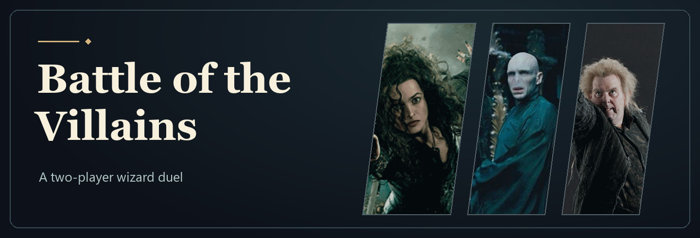

<p align="center">
  
</p>

<h1 align="center">Battle of the Villains</h1>

<p align="center"><strong>A two-player, turn-based wizard duel built with Python and Tkinter.</strong></p>

<p align="center">
  <a href="#quick-start">Quick start</a> &nbsp;·&nbsp;
  <a href="#how-to-play">How to play</a> &nbsp;·&nbsp;
  <a href="#roster">Roster</a> &nbsp;·&nbsp;
  <a href="#project-files">Project files</a>
</p>

## The duel

Pick one of six characters, then choose a strike, a spell, or a defensive move each round. Each character has different stats for strikes, spells, and defense. The server resolves the round after both players have chosen and sends each player their updated life and magic.

Battle of the Villains began as an Advanced Programming final project in July 2023.

## Roster

| Bellatrix Lestrange | Draco Malfoy | Lord Voldemort |
| :---: | :---: | :---: |
|  |  |  |
| **Dolores Umbridge** | **Lucius Malfoy** | **Peter Pettigrew** |
|  |  |  |

## Quick start

You'll need **Python 3 with Tkinter**, a desktop session, and three terminals on the same computer. The game uses the Python standard library.

```bash
git clone https://github.com/HosnaSltn/battle_of_the_villains.git
cd battle_of_the_villains
python -m tkinter
```

Close the Tkinter test window, then open three terminals in the repository. Run the following commands in order.

| Terminal | Commands |
| --- | --- |
| 1 · Server | `python game_server.py` |
| 2 · Player 1 | `cd asset`<br>`python ../game_client.py` |
| 3 · Player 2 | `cd asset`<br>`python ../game_client.py` |

The clients connect to `127.0.0.1:8000`. The first client waits for the second before either game window opens. Launch each client from `asset/` so Tkinter can find the character portraits. Use `python3` in place of `python` if that is your Python 3 command.

## How to play

1. Click **Start** in each client and select a character to see their portrait and stats.
2. Click **pick this character**, then choose **Strike**, **Defense**, or one of the three spells.
3. Watch your **Life** and **Magic** bars after each round. Drop your opponent's life to zero to win. If both players reach zero in the same round, the match is a draw.
4. On the results screen, choose **another match** to play again.

## Project files

| Path | Role |
| --- | --- |
| [`game_server.py`](game_server.py) | Accepts both connections, resolves turns, and writes the match log. |
| [`game_client.py`](game_client.py) | Connects to the server and exchanges game messages. |
| [`game_window.py`](game_window.py) | Builds the Tkinter screens and handles player selections. |
| [`game_characters.py`](game_characters.py) | Defines character stats and combat calculations. |
| [`asset/`](asset/) | Holds the character portraits, the original report, and a sample match log. |

## License

[MIT](LICENSE)
